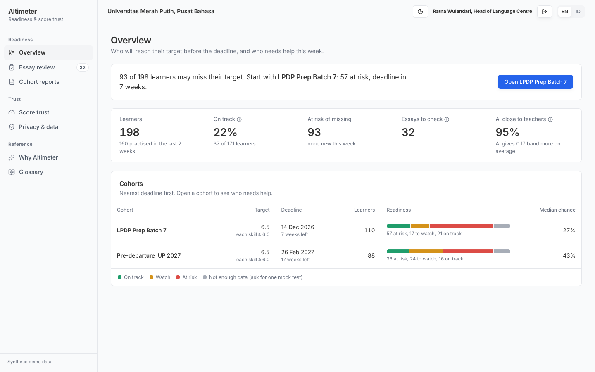
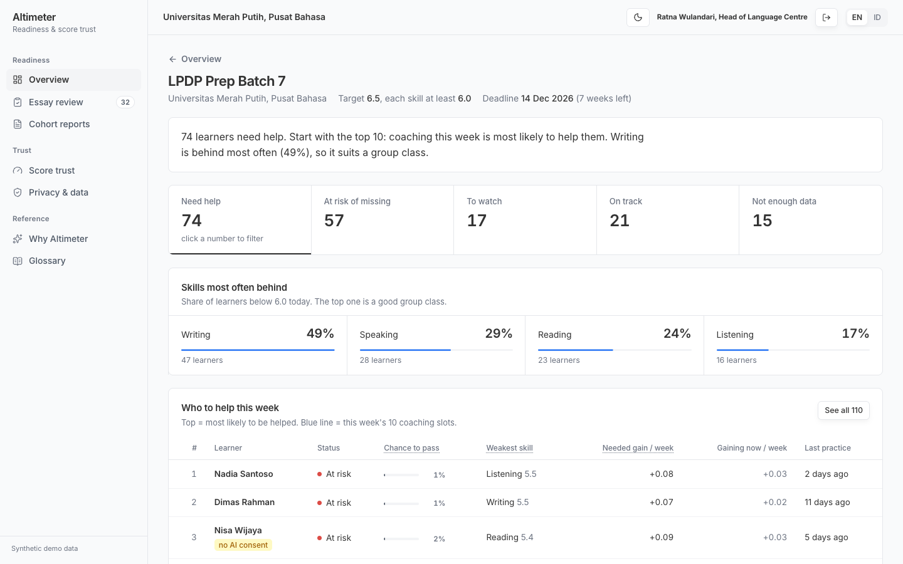
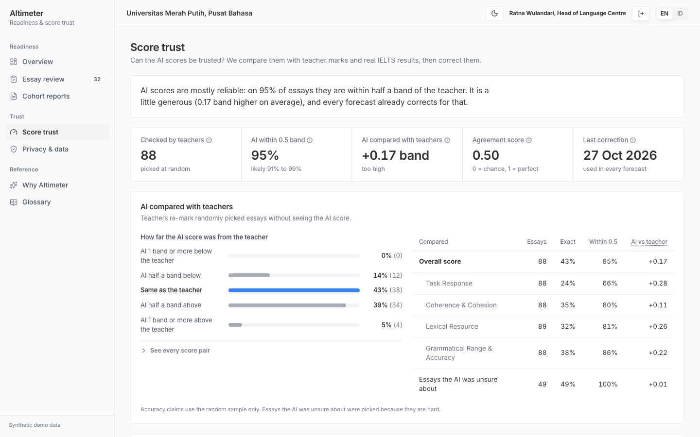
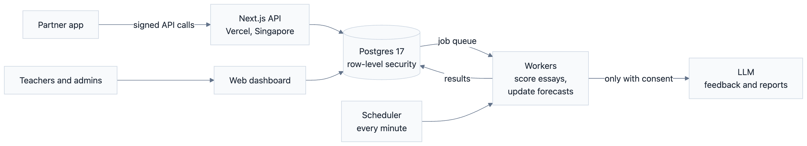

# Altimeter

[](https://github.com/rafidhiyaulh/altimeter/actions/workflows/ci.yml) [](https://github.com/rafidhiyaulh/altimeter/actions/workflows/codeql.yml)

**A dashboard that tells an English test-prep school who will reach their IELTS target on time, who needs help this week, and how far the AI scores can be trusted.**

**Live demo:** https://altimeter-readiness.vercel.app (pick a role, no account needed)



## What it answers

| Question a school asks | What Altimeter shows |
|---|---|
| Who will hit the target band by the deadline? | Each learner's chance to pass, the skill holding them back, and a weekly list of who to coach first |
| Can we trust the AI scores? | Teachers re-mark a random 1 in 10 essays without seeing the AI score. Practice scores are compared with real IELTS results, and every forecast is corrected for the gap |
| Is children's data safe? | Guardian consent before any essay goes to AI, automatic deletion, export and erasure on request, and each school sees only its own data |

| Cohort: who to help this week | Score trust: how close the AI is to teachers |
|---|---|
|  |  |

## Results

Measured on data the models never saw during training.

| What was tested | Result |
|---|---|
| Writing scorer on new essay prompts | Average gap 0.45 band; 82% of essays within half a band (always guessing the average: 0.59 and 60%) |
| Writing scorer against human raters (ELLIPSE corpus, 3,911 essays) | Rank agreement 0.39 (essay length alone: 0.24). Moderate, which is why teacher checks and correction are built in |
| Readiness forecast for writing, with correction from real results | Average gap 0.63 → 0.47 band; within half a band 62% → 81% |
| "Chance to pass", 4 weeks before the test | Brier score 0.070 → 0.054 with correction (lower is better) |
| Job queue under load (500 essays re-scored on production) | 1 worker: 18 jobs/s. 8 workers: 138 jobs/s, no failures, 95% of essays re-scored within 4.4 s (details below) |
| Live system tests | 54 integration checks and 24 browser flows pass against production |

**About the data.** The schools, learners, teacher marks and official results are synthetic. The 2,224 essays are real learner essays from a public corpus (Apache-2.0), scored by the real model through the real queue. Before training, the corpus was cleaned: 4,234 duplicate essays removed and the split redone by prompt, because about 1,000 prompts appeared in both its train and test sets.

## How it is built



<sub>Diagram source: [docs/architecture.mmd](docs/architecture.mmd)</sub>

| Area | What is in it |
|---|---|
| **Relational database** | Postgres 17. Monthly partitions for attempts. Scores and forecasts keep every version with its valid dates, and a partial unique index allows exactly one current row. Teacher reviews and the audit log are append-only and hash-chained, so a silent edit is detectable. Users write only through database functions |
| **APIs and backend** | Next.js 16 route handlers. A partner API (OpenAPI 3.1) with keys stored as SHA-256 hashes, HMAC-signed requests with a 5-minute window, `Idempotency-Key` replay, RFC 9457 error bodies, zod validation and per-key rate limits in Postgres |
| **Distributed systems** | A pgmq job queue with competing serverless workers. A visibility timeout gives at-least-once delivery and idempotent writes make the effect exactly-once. Failed jobs move to a dead-letter queue after 3 tries. Forecast jobs for the same learner are coalesced. pg_cron calls the workers every minute with a secret kept in Vault. A built-in drill kills a worker mid-batch and checks that every job still finishes |
| **AI and ML** | One LightGBM model per IELTS writing criterion. Features are written once in TypeScript and used by both Python training and live scoring (they match to within 1e-9). Conformal ranges, and a per-essay explanation of what moved the score. Readiness uses a Kalman filter per skill and 4,000 Monte Carlo runs with IELTS rounding, corrected against official results. LLM feedback must quote the essay word for word, and reports may only cite numbered facts. Anything that fails the check is dropped |
| **Cloud and deployment** | Vercel (Singapore) and Supabase (Singapore), close to Indonesian users. A standalone Dockerfile runs the same app on any VPS. GitHub Actions runs lint, type checks, tests, the production build, the Docker build and the ML package checks on every push. Request logging, every-minute alerts and a health endpoint cover monitoring |
| **Security and privacy** | Row-level security per school, cohort and learner. The app's login role owns nothing and switches to one narrow role per request path. Guardian consent is checked in the database before any LLM call on a minor's essay. Automatic retention purge, data export and erasure, CSP and HSTS headers, login rate limits, and a mapping to Indonesia's data-protection law (UU PDP No. 27/2022) |

## Scaling and monitoring

The queue was load-tested on production by re-scoring 500 essays with 1, 2, 4 and 8 competing workers
(`web/scripts/loadtest.mjs`, raw numbers in [`docs/load_test.json`](docs/load_test.json)). Each essay also
triggers a forecast update, so about 770 jobs run per round.

| Workers | Queue drained in | Jobs per second | Essay re-scored within (p50 / p95) | Failed |
|---|---|---|---|---|
| 1 | 42.5 s | 18 | 16.2 s / 27.9 s | 0 |
| 2 | 21.8 s | 36 | 9.6 s / 15.6 s | 0 |
| 4 | 9.7 s | 80 | 4.7 s / 7.3 s | 0 |
| 8 | 5.7 s | 138 | 3.0 s / 4.4 s | 0 |

Throughput grows almost linearly up to 8 workers (7.6× for 8×). More workers were not tested.

Every API request is logged after its response is sent (route, status, duration). A pg_cron job checks
every minute and opens or closes alerts for a stuck queue, dead-letter jobs, worker failures, a server-error
rate above 5% or a p95 above 2 s. The System page shows latency per route and the alerts, and
`/api/health` reports the database, queue and open alerts for an external uptime monitor.

## Security

See [SECURITY.md](SECURITY.md) for what is protected, the threats considered, the controls, and the known
limits. CI runs secret scanning on the full history, a dependency audit and CodeQL on every push.

## Project layout

```
ml/              Python: corpus cleaning, writing model, human-rater check, synthetic cohorts
docs/            screenshots, architecture diagram and load-test results
db/migrations/   schema, row-level security, runtime functions
web/             Next.js app, partner API, workers, setup and test scripts
```

<details>
<summary><b>Run it yourself</b></summary>

Requires Node 24, pnpm, Python 3.12 with uv, the Supabase CLI and a Supabase project. Copy `.env.example` to `.env.local` and fill it in.

```bash
# 1. data and models
cd ml && uv sync && uv run python -m altimeter_ml.prep && cd ../web
node scripts/dump-features.mjs ../ml/data/work/essays.jsonl ../ml/data/work/features.jsonl
cd ../ml && uv run python -m altimeter_ml.train_writing && uv run python -m altimeter_ml.validate_ellipse && uv run python -m altimeter_ml.synth

# 2. database and demo data
cd ../web && pnpm install
node scripts/backtest-readiness.mjs ../ml/data/work ../ml/artifacts/readiness_backtest.json
node --env-file=../.env.local scripts/migrate.mjs
node scripts/build-seed.mjs ../ml/data/work ../db/seed && node --env-file=../.env.local scripts/seed.mjs ../db/seed
node --env-file=../.env.local scripts/setup-auth.mjs
node --env-file=../.env.local scripts/setup-cron.mjs https://<your-url>
node --env-file=../.env.local scripts/seed-reviews.mjs ../db/seed/labels.json

# 3. tests
pnpm test && pnpm lint
node --env-file=../.env.local scripts/sit.mjs https://<your-url>
node --env-file=../.env.local scripts/uat.mjs https://<your-url> /tmp
node --env-file=../.env.local scripts/loadtest.mjs https://<your-url> 500 ../docs/load_test.json
```

</details>

---

A concept prototype by Muhammad Rafi Dhiyaulhaq, built with Acsent's school programme in mind. Not affiliated with or endorsed by Acsent.
